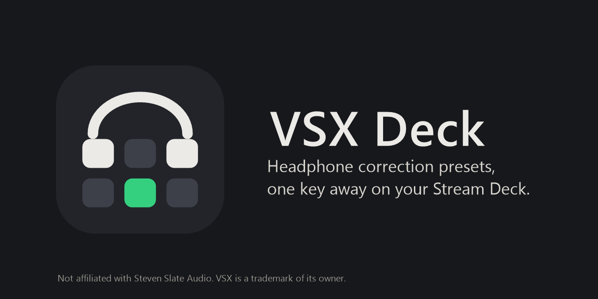
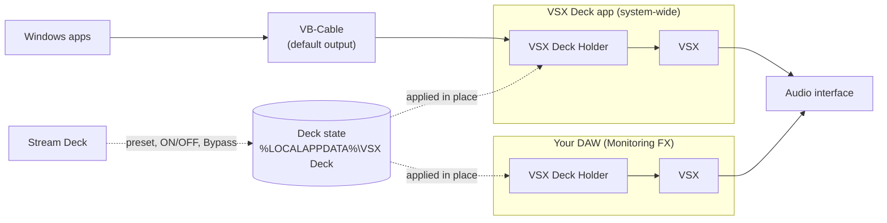

# VSX Deck



Switch and save **Steven Slate Audio VSX** presets from an **Elgato Stream Deck**, in your DAW or system-wide.

- **ON/OFF**: turns VSX on or off. Lights green and shows the current room name when on. Expect a volume jump on switching off.
- **Preset keys** (up to 99): switch rooms instantly. The active one is green and shows the room's picture.
- **Save**: hold 1 s to store the current VSX settings in the selected preset slot.
- **Bypass**: VSX's own level-matched bypass.
- **VSX Deck app** (system-wide install): Opens the software window or brings it to front.

> **Use VSX Deck or VSX Systemwide, not both.** Both programs send system audio through VSX, so you get double processing and latency if you run both.

## Install

1. Install **Slate VSX** and the **Elgato Stream Deck** app (6.4 or later). No Node.js needed: the Stream Deck app
   downloads its own the first time it loads the keys, so it needs internet once.
2. Close your DAW. Open **PowerShell** from the Start menu and run, in this folder:
   ```powershell
   powershell -ExecutionPolicy Bypass -File .\Install.ps1
   ```
   Choose what to install:
   - **System-wide**: all Windows audio goes through VSX. Installs VB-Cable, the VSX Deck app, the DAW
     plugin and the Stream Deck keys.
   - **DAW only**: the DAW plugin and the Stream Deck keys, doesn't touch Windows audio.
3. **System-wide**: Windows must play into **CABLE Input (VB-Audio Virtual Cable)**. If it doesn't, VSX Deck's window
   says so: press **Play through VSX** (or set CABLE Input as the default output in Sound settings).
4. **DAW**: rescan plugins and put **VSX Deck Holder** where VSX was (in Reaper: View → Monitoring FX).

Running the installer again updates everything and keeps your deck layout. Options: `-Mode full|daw`, `-Vsx <VSX.dll or its folder>`,
`-VstDir <folder for the DAW plugin>`, `-DryRun` (shows what it would do, changes nothing).

Don't run it from a terminal inside a Microsoft Store app: Windows would hide the files it writes from VSX Deck.

## Use

- **New preset**: press an empty preset key ("save here"), set up the room in a VSX window, then hold **Save**.
  The key shows ✓, or ⚠ if no VSX window was open.
- **Change a preset**: select it, adjust VSX, hold **Save**. VSX Deck acts like a single source of truth that controls both versions (app and DAW) at once. Save takes the settings from the VSX window on screen; the app hidden in the tray doesn't count.
- **Clear a preset**: hold its key 1.5 s. It moves to `%LOCALAPPDATA%\VSX Deck\cleared\`, so you can get it back.
- **More presets**: drag **VSX Preset** onto any key. It takes the next free number.
- **ON** goes back to the last preset (before you've saved any, it turns VSX on as it is). **OFF** fades to dry in 30 ms, in the app and your DAW alike. The DAW's own on/off checkbox for the plugin stays ticked
  (a VST2 plugin can't change it), so while OFF, VSX's window shows a strip saying so.
- **Bypass** stays on when you switch rooms and is never saved into a preset.
- **Dashed amber outline**: nothing running VSX has confirmed the change yet (the app or your DAW is closed).

Deck layout: presets 1–10 on the top two rows; Bypass, App, Save and ON/OFF on the bottom row.

### VSX Deck app

- Header buttons: ⚙ Settings, ⓘ About, ♥ Support. Closing the window hides it to the tray.
- **Settings**: output device, latency (20 / 30 / 50 ms), start at login, take room pictures on keys, open the presets folder.
- **Dropouts** in the header counts audio gaps. If you hear crackles and it climbs, raise the latency.
  Clicks when a player starts, stops or skips usually come from the player itself.
- **Room pictures**: taken from your own VSX window, on your PC, for your own deck. They are Slate's artwork:
  don't share them. This repository contains none.

## Remove

Close your DAW, then run:

```powershell
powershell -ExecutionPolicy Bypass -File .\Uninstall.ps1
```

Choose everything, or only the system-wide part. Your presets are kept unless you say otherwise. VB-Cable stays
installed; remove it in Settings → Apps if nothing else needs it, and set your default output back.

## How it works

VSX Deck is a small **VST host**. **VSX Deck Holder** is a VST2 plugin that runs VSX inside it and applies the deck's
choices to it. The **VSX Deck app** runs VSX Deck Holder and plays system audio through it, similar to how VSX Systemwide software works.



Solid lines carry audio, dotted lines carry control.

| File | What |
|---|---|
| `vsxdeckholder.c` | VSX Deck Holder: keeps one VSX running and swaps its state in place, so switching has no reload and no volume jump. |
| `vsxdeck.cs` | VSX Deck app: system audio through VSX, VSX's window, tray, key pictures. |
| `com.vsxdeck.sdPlugin\` | Stream Deck keys (run on the Stream Deck app's own Node.js). For developers: `node plugin.js` runs its self-check. |
| `Install.ps1`, `Uninstall.ps1` | Setup and removal. |
| `build.ps1`, `make-icons.ps1` | Rebuild `bin\`; draw the icons and this page's picture. |

Presets and settings live in `%LOCALAPPDATA%\VSX Deck`, which only your Windows account can change.

### Why VST2 only

- VST2 is a small C interface, so VSX Deck Holder is one short C file with no SDK. Its state calls let it switch
  rooms instantly without reloading VSX.
- VST3 would need a much bigger C++ host built on Steinberg's SDK, for no gain here.
- If Slate drops the VST2 version of VSX, this kit stops working.

## Disclaimers

- **Independent project**, not affiliated with or endorsed by Slate Digital or Steven Slate Audio. You need your own
  licensed VSX.
- **May become obsolete.** VSX has no way to switch rooms from an external controller. Whenever Slate adds one, this software loses its reason to exist, and you are encouraged to switch to the official solution.
- **No reverse engineering.** VSX is used only through the standard VST2 plugin interface and the settings VSX saves
  itself. No VSX code was decompiled, disassembled or modified.
- **Low-level code generated with AI.** This software is made with Claude Code. The system-wide part is a VST host that works directly with Windows audio and the VST2 interface. The author tested it on three separate Windows machines before making the repository public and encountered no issues. Still, use it at your own risk. It is recommended to initially test it at low volume levels.

## Feedback and scope

VSX Deck is built to support one person's workflow, and that workflow shapes how it develops.

- **Bug reports** are welcome: open an issue.
- **Feature requests** are considered only if they fit the author's workflow.
- **Want something different?** You're welcome to fork it and make it your own; the MIT license allows that.

## License

MIT, see [LICENSE](LICENSE). Covers this kit's code and artwork only. VSX, VB-Cable, Reaper and Stream Deck belong to
their owners.
