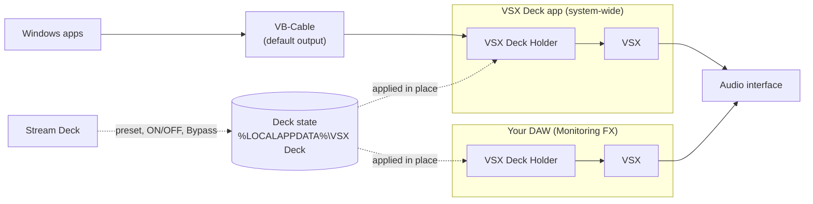

# VSX Deck


Switch and save **Steven Slate Audio VSX** presets from an **Elgato Stream Deck**, in your DAW or system-wide.

- **ON/OFF**: turns VSX on or off. Lights green and shows the current room name when on. Expect a volume jump
  when switching off, as VSX lowers the input signal. Use when switching to speakers or different headphones while
  using the same output, otherwise use Bypass.
- **Preset keys** (up to 99): switch room presets.
- **Save**: press and hold to store the current VSX settings in the selected preset.
- **Bypass**: VSX's own level-matched bypass.
- **App** (system-wide install): opens the VSX Deck window, or brings it to the front.

> **Use VSX Deck or VSX Systemwide, not both.** Both send system audio through VSX, so running both gives you double
> processing and extra latency.

> **Windows only** (Windows 10 or 11, 64-bit). The author doesn't have a Mac and has no plans for a Mac version.

## How it works

VSX Deck is a small **VST host**. **VSX Deck Holder** is a VST2 plugin that runs VSX inside it and applies the deck's
choices to it. The **VSX Deck app** runs VSX Deck Holder and plays system audio through it, similar to VSX Systemwide
software.



Solid lines carry audio, dotted lines carry control.

| File | What |
|---|---|
| `vsxdeckholder.c` | VSX Deck Holder: keeps one VSX running and swaps its state in place, so switching has no reload and no volume jump. |
| `vsxdeck.cs` | VSX Deck app: system audio through VSX, VSX's window, tray, key pictures. |
| `com.vsxdeck.sdPlugin\` | Stream Deck keys, run by the Stream Deck app's own Node.js. For developers: `node plugin.js` runs its self-check. |
| `Install.ps1`, `Uninstall.ps1` | Setup and removal. |
| `build.ps1`, `make-icons.ps1` | Rebuild `bin\`; draw the icons and this page's picture. |

Presets and settings live in `%LOCALAPPDATA%\VSX Deck`, which only your Windows account can change.

## Install

1. Install **Slate VSX** (with its VST2 format) and the **Elgato Stream Deck** app (6.4 or later). Run the
   **Elgato Stream Deck** app at least once before installing **VSX Deck**.
2. Close your DAW. Open **PowerShell** from the Start menu and run in the folder you cloned:
   ```powershell
   powershell -ExecutionPolicy Bypass -File .\Install.ps1
   ```
   Choose what to install:
   - **System-wide**: all Windows audio goes through VSX. Installs VB-Cable (asks first), the VSX Deck app, the
     DAW plugin and the Stream Deck keys.
   - **DAW only**: the DAW plugin and the Stream Deck keys. Windows audio isn't touched.
3. **System-wide**: Windows must play into **CABLE Input (VB-Audio Virtual Cable)**. If it doesn't, the VSX Deck
   window suggests to **Play through VSX**.
4. **DAW**: rescan plugins and put **VSX Deck Holder** where VSX was (in Reaper: View → Monitoring FX).

**VSX Deck** will not work without **VSX** or **Stream Deck** installed. Rerunning the installer updates everything
and keeps your deck profile. Run it from a normal PowerShell window, not a terminal inside a Microsoft Store app:
Windows would hide the files it writes from VSX Deck.

Options: `-Mode full|daw`, `-Vsx <VSX.dll or its folder>`, `-VstDir <folder for the DAW plugin>`, `-DryRun` (shows
what it would do without installing anything).

## Use

- **New preset**: press an empty preset key, set up the room in a VSX window, then hold **Save**.
  The key shows ✓ on completion or ⚠ if something goes wrong. Save takes the settings from the VSX window on screen.
- **Change a preset**: the app and your DAW always follow the same preset.
- **Clear a preset**: press and hold for 1.5 s. It moves to `%LOCALAPPDATA%\VSX Deck\cleared\`.
- **More presets**: drag **VSX Preset** onto any key.
- **ON** goes back to the last preset. **OFF** fades to dry in 30 ms. A VST2 plugin can't change the DAW's on/off
  checkbox, so the **VSX Deck Holder** window shows a status warning instead.
- **Bypass** stays on when you switch rooms, not saved into a preset.
- **Dashed amber outline**: nothing running VSX has confirmed the change yet (the app or your DAW is closed).

Deck layout: presets 1–10 on the top two rows; Bypass, App (system-wide only), Save and ON/OFF on the bottom row.

### VSX Deck app

- **Header**: the audio route and basic controls. Closing the window hides it to the tray; exit the app by
  right-clicking the tray icon.
- **Warnings** in the header: if Windows plays into a different device, or if VSX Systemwide is running alongside.
- **Settings**: output device, latency (20 / 30 / 50 ms), start at login, room pictures on keys, presets location.
- **Sample rates** follow your output device: if it changes rate, VSX Deck switches VB-Cable to match.
- **Dropouts** in the header counts audio gaps. If you hear crackles and it climbs, raise the latency. If they
  persist on any latency, open an issue, although support is not guaranteed.
- **Room pictures**: taken from your own VSX window, on your PC, for your own deck. They are Slate's artwork:
  don't share them. This repository contains none.

## Remove

Close your DAW, then run:

```powershell
powershell -ExecutionPolicy Bypass -File .\Uninstall.ps1
```

VB-Cable stays installed: remove it in Settings → Apps if nothing else needs it, and set your default output back.

## Disclaimers

- **Independent project**, not affiliated with or endorsed by Slate Digital or Steven Slate Audio. You need your own
  licensed VSX.
- **May become obsolete.** VSX has no way to switch rooms from an external controller, and this is the only reason
  this software exists. Whenever Slate adds similar functionality, you are encouraged to switch to the official
  solution.
- **No reverse engineering.** VSX is used only through the standard VST2 plugin interface and the settings VSX saves
  itself. No VSX code was decompiled, disassembled or modified.
- **Low-level code generated with AI.** This software is made with Claude Code. The system-wide part is a VST host
  that works directly with Windows audio and the VST2 interface. The author tested it on two separate Windows
  machines before making the repository public and encountered no issues. Still, use it at your own risk, and start
  at a low volume.

## Why VST2 only

- VST2 is a small C interface, so VSX Deck Holder is one short C file with no SDK. Its state calls let it switch
  rooms instantly without reloading VSX.
- VST3 would need a much bigger C++ host built on Steinberg's SDK and bloat the scope of the project.
- If Slate drops the VST2 version of VSX, this kit stops working.

## Feedback and scope

VSX Deck is built to support one person's workflow, and that workflow shapes how it develops.

- **Bug reports** are welcome: open an issue.
- **Feature requests** are considered only if they fit the author's workflow.
- **Want something different?** You're welcome to fork it and make it your own; the MIT license allows that.

## Credits

VSX Deck's system-wide mode relies on **VB-Cable** by VB-Audio Software
([vb-audio.com/Cable](https://vb-audio.com/Cable/)), which is donationware: if you use it, consider supporting them.
Stream Deck is a trademark of Elgato (Corsair). VSX Deck is not affiliated with VB-Audio or Elgato.

## License

MIT, see [LICENSE](LICENSE). Covers this kit's code and artwork only. VSX, VB-Cable, Reaper and Stream Deck belong to
their owners.
